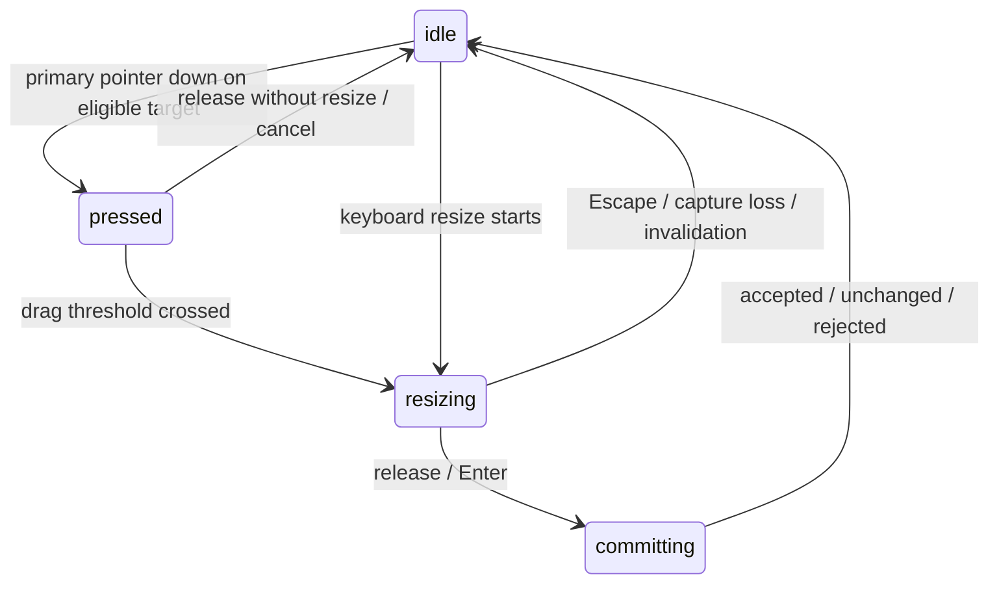

# DashPanel resizing and Resize Lab proposal

> Contract: Draft
> Implementation: Planned
> Evidence: Source and contract inspection at `9229caf4ff20c0f82b2a6a5bc1e23ddb4db4aea6`,
> 2026-11-12. No resizing implementation or runtime verification accompanies this plan.
> This proposal does not replace the accepted references until its decision slice lands.

## Scope

Let a user resize an ordinary Panel from its four sides and four corners, understand which targets
are available, retain deliberate sizing, and restore the application's preferred size. Automatic
content sizing and temporary boundary accommodation continue to work. Developers receive the same
commands for custom controls, and applications can observe Panel-owned interactions through Nexus.

Interpret “automatic resizing for any side or corner” as manual eight-direction resizing plus
automatic response to content and available space. “Dash stack” is treated as DashList in this
repository. Optional handles primarily mean visible resize grips; a dedicated move grip is also
specified below without creating a general header-slot API.

John confirmed that content growth after manual sizing should retain the manual size and scroll.
Explicitly enabled content minimums may temporarily constrain that size. Resizing only width must
leave automatic height automatic, and vice versa.

This is a DashPanel extension during foundational stabilization, with necessary Nexus and Dev
Bridge work. Picodash only reexports the accepted foundation contracts. DashList remains independently
usable and owns its responsive layout and scrolling bands.

### Non-goals

Modal drawer/sheet resizing, persisted dock-allocation ratios, automatic tiling, aspect-ratio locks,
size snapping, multi-touch scaling, undo history, arbitrary DOM-event recording, and retrospective
instrumentation of every Dashlet control are outside this cut. Existing Panel movement/actions and
the DashList reorder interaction must exercise the shared observation contract; a wider event
inventory is a separately bounded follow-up.

## Evidence baseline

| Source                                                                                                                                                                                                                     | Fingerprint or date                           | Supports                                                                                                                                                         | Limits                                                                                                                         |
| -------------------------------------------------------------------------------------------------------------------------------------------------------------------------------------------------------------------------- | --------------------------------------------- | ---------------------------------------------------------------------------------------------------------------------------------------------------------------- | ------------------------------------------------------------------------------------------------------------------------------ |
| User request and sizing answer                                                                                                                                                                                             | 2026-11-12                                    | Eight targets, configurable constraints, restoration, event reporting, configurable Lab, manual size wins over growth                                            | Public names and placement exceptions require a proposal                                                                       |
| [DashPanel reference](../reference/dashpanel.md#resize-and-responsive-behavior), [decisions](../reference/dashpanel-contract-decisions.md)                                                                                 | Baseline commit above; initial worktree clean | Explicit no-resize contract; preferred position, intrinsic height, boundary projection, dock allocation, keyboard parity                                         | Documentation has mixed implementation-status annotations; no live claims inferred                                             |
| [Panel implementation](../../packages/dashpanel/src/index.tsx)                                                                                                                                                             | Same baseline                                 | CSS preferred width, intrinsic/minimum-height measurement, observers, Motion, pointer/keyboard movement; active movement cancels on measured geometry changes    | Inspected source, not exercised browser behavior; resize-driven measurements need different cancellation handling              |
| [Panel controller](../../packages/dashpanel/src/runtime/panel-controller.tsx), [geometry](../../packages/dashpanel/src/geometry/placement-geometry.ts), [runtime](../../packages/dashpanel/src/runtime/panel-runtime.ts)   | Same baseline                                 | Existing commands, projection helpers, scoped layout writes, allocation                                                                                          | No size commands or resize-session model                                                                                       |
| [Nexus reference](../reference/nexus.md#built-in-metadata-payload-status), [codec](../../packages/nexus/src/metadata.ts), [ADR 0002](../adr/0002-provider-level-nexus-and-scoped-views.md)                                 | Same baseline                                 | Strict complete layout record currently contains placement and preferred position; interaction snapshots cover bindings/items; high-frequency visuals stay local | No public general Panel interaction stream found in the inspected root/integration surfaces                                    |
| [Dev Bridge types](../../packages/dev-bridge/src/types.ts), [operations guide](../development/agent-dev-bridge.md)                                                                                                         | Protocol v2 at baseline                       | Explicit scope disclosure, authenticated inspect/set-values/wait, generation fencing                                                                             | No interaction-event disclosure or event cursor; ordinary scope inspection proves durable metadata only                        |
| [Testing policy](../../TESTING.md#the-single-contract-lab), [presets](../../apps/lab/src/lib/contract-lab/presets.ts), [Lab host](../../apps/lab/src/components/contract-lab/specimen-host.tsx)                            | Same baseline                                 | One `/lab`, exactly six presets, stable Console/status, driver limited to setup, 40-test ceiling                                                                 | A seventh preset or separate Resize route would require an unnecessary policy change                                           |
| [ADR 0006](../adr/0006-dashlist-responsive-measurement.md), [shared UI](../reference/ui.md#animation-implementation-policy)                                                                                                | Same baseline                                 | No inline containment on Lists; owner-document measurement; Motion and reduced-motion obligations                                                                | Arbitrary children do not supply universal intrinsic metrics                                                                   |
| [Pointer Events](https://www.w3.org/TR/pointerevents3/), [WCAG dragging guidance](https://www.w3.org/WAI/WCAG22/Understanding/dragging-movements.html), [Resize Observer draft](https://drafts.csswg.org/resize-observer/) | Read 2026-11-12                               | Pointer capture/cancellation, non-drag pointer alternative, box measurement and loop hazards                                                                     | Standards inform design; they do not prove browser support or this implementation; Resize Observer source is an editor's draft |

Accepted ADRs and decisions outrank references, roadmap, and prototype code in that order. This
proposal names intentional revisions rather than silently changing accepted behavior. Browser and
Bridge evidence will be independent of implementation inspection.

## Recommended behavior and API

### Preferred, manual, and resolved sizes

Use three separate inputs/views:

| Layer              | Meaning                                                                   | Lifetime                                     |
| ------------------ | ------------------------------------------------------------------------- | -------------------------------------------- |
| Preferred          | Application `width`/`height`, theme defaults, or content-derived size     | Declared policy; not copied into persistence |
| Manual override    | User-selected numeric width and/or height in CSS pixels                   | Settled Nexus scope metadata                 |
| Resolved rectangle | Projection of those inputs into current bounds, placement, and allocation | Transient geometry; never saved              |

An axis is manually sized when its override exists, even if its number happens to equal the
preferred size. Derive `manuallySized` and per-axis indicators from override presence; do not store
another boolean. Growing or shrinking content does not rewrite a manual override. A width-only
override still allows natural height to follow wrapping and disclosure.

On boundary contraction, retain both manual axes and preferred position. On expansion, resolve
again from those retained inputs. Hiding/reopening, collapse/expand, minimize/reveal, docking and
detaching must preserve them. An allocation-owned axis can temporarily make an override dormant.

### Configuration

Keep the existing `width` input and add its direct counterparts. Proposed example, not a current
compilable API fixture:

```tsx
<DashPanel
  id="inspector"
  title="Inspector"
  width={360}
  height="auto"
  minWidth={240}
  maxWidth={720}
  minHeight={160}
  maxHeight={800}
  resize={{ handles: 'auto' }}
>
  <Inspector />
</DashPanel>
```

Proposed rules:

- `width` retains the accepted CSS/intrinsic-width support. `height` defaults to `auto`; numeric
  dimensions mean outer border-box CSS pixels. Min/max accept non-negative finite pixels or a
  documented CSS length/percentage subset. Resolve percentages against the definite effective
  boundary, never against the size being solved. Reject unsupported expressions and numeric
  `min > max` at configuration boundaries; do not silently swap them.
- Omitted bounds use the measured usable shell minimum and current available maximum. Resize is
  enabled by default on eligible axes in this pre-v1 proposal. `resize={false}` preserves the
  previous interaction policy. `resize` may narrow `targets` from the eight physical directions
  and choose `handles: 'auto' | 'always' | 'hidden'`. Equal preferred/min/max locks that axis and
  removes its unusable targets. Equal width values alone do not disable vertical resizing.
- Add optional `contentConstraints={{ minWidth: true, maxHeight: true }}`. Each independent flag
  adds a measured content bound to the matching explicit bound; omission adds none. Width minimum
  uses min-content contribution, width maximum uses max-content contribution, and height bounds
  use natural content height at the candidate width, plus shell chrome. Enabling both height
  bounds deliberately locks height to content. All applied measurements are observable.
- For virtualized, absolutely positioned, canvas, or otherwise unmeasurable content, accept an
  application-supplied, validated `contentMetrics` record with optional finite `minWidth`,
  `maxWidth`, `minHeight`, and `maxHeight`. These replace automatic measurements for those
  quantities. Missing measurements remain unavailable, never a fabricated zero. Declared bounds
  still apply while measurement is pending; unavailable requested content bounds report a safe
  diagnostic. No second React mount is used to measure children.
- Reserve all physical and logical size styles that could compete with the solver, including
  currently exposed `style.height`/`maxWidth`/`maxHeight`. Keep theme preferred-width support;
  product-owned bounds and resize feedback use semantic `--picodash-panel-*` tokens. This requires
  explicit type-test and stylesheet-contract updates.

These are proposed named props, not an arbitrary sizing-options bag. The contract slice must turn
this example into an exercised type fixture and enumerate the supported CSS grammar. The first
implementation can restrict new bound expressions to pixels, `rem`, and percentages while retaining
existing preferred-width syntax; broader CSS math must not be claimed without a resolver proof.

### Constraint precedence and impossible configurations

Resolve desired width first, then natural height at that width. Intersect explicit bounds, requested
content bounds, shell minimum, effective boundary/insets, and dock allocation. Return the resolved
rectangle and structured reasons for every binding constraint.

Use the existing explicit `boundary`/`boundaryInset` contract for container restrictions. A Panel's
JSX parent, portal parent and geometry boundary need not be the same element; do not infer a new
boundary from whichever DOM parent happens to contain its portal.

There is no solution when a minimum exceeds available space or another maximum. A fixed 600px
Panel cannot fit a 400px container while respecting both. Use this explicit recovery policy:

1. Invalid declarations fail before interaction. Dynamic content/space conflicts do not crash an
   observer callback.
2. Containment and allocation caps win during projection, followed by explicit maximums, content
   maximums, then satisfiable minimums. Report `minimum_unavailable` or `content_bounds_conflict`
   with safe numeric context. This is a temporary relaxation of a minimum, never a saved change.
3. Keep the header and scrolling content usable where the boundary permits. If even shell chrome
   cannot fit, suppress resize targets and expose the constrained reason; the host-owned reopen
   control remains outside the specimen. Do not claim arbitrary tiny boundaries are fully usable.

At an ordinary limit, the dragged edge stops; edges never cross or produce negative dimensions.
Do not automatically detach or change placement during a resize.

### Eight targets and placement semantics

Free Panels expose `n`, `ne`, `e`, `se`, `s`, `sw`, `w`, and `nw`, filtered by configured and locked
axes. A free resize holds the opposite edge/corner stationary. West/north changes update position
and size together in one transaction. Width changes can reflow automatic height without making
that height manual.

Snapped and docked Panels retain their named anchor. Showing all eight targets there would promise
movement that conflicts with the anchor. Offer only targets consistent with that placement:

| Placement                                                          | Resizable geometry                                                                              |
| ------------------------------------------------------------------ | ----------------------------------------------------------------------------------------------- |
| Free Floating/Hybrid                                               | All eight directions                                                                            |
| Corner snapped/docked                                              | Two inward-facing edges and their shared corner; boundary-facing edges unavailable              |
| Edge-midpoint snap or center dock                                  | Inward perpendicular edge; centered-axis edges resize symmetrically; corners combine both rules |
| `full-left` / `full-right` dock                                    | Inward horizontal edge only; allocation owns height                                             |
| `full-top` / `full-bottom` dock                                    | Inward vertical edge only; allocation owns width                                                |
| Collapsed, minimized, hidden, modal, or unusably constrained Panel | No resize targets; keep dormant overrides                                                       |

A centered-axis handle moves by the pointer delta while the opposite edge mirrors it, so total size
changes by twice that delta. Include this rule in the geometry tests and Lab explanation. Users can
move a Panel free to regain eight-target resizing. Dock resize updates peer width-dependent
allocation previews without claiming new slots or saving peers' geometry. Full-dock allocation
ratios stay unchanged. A one-Panel Lab therefore still needs a separate existing peer-placement
journey to prove allocation compatibility.

### Manual changes while already constrained

Start a gesture from the actual rendered rectangle. On commit, save the accepted rendered value
only for the axes deliberately manipulated. Preserve untouched manual axes and unaffected preferred
coordinates. For west/north, save the changed coordinate from the rendered opposite-edge anchor.
No visible accepted change means no write or new manual marker.

Example: stored size `600 × 500`, temporarily rendered `300 × 250`. An east-edge resize to `320`
saves width `320`, retains height `500`, and retains the untouched preferred position. Re-expansion
restores height `500`; it must not restore width `600` or accidentally save height `250`. Restoring
preferred size clears those manual axes even when current constraints make the immediate result
look unchanged. A command reports that accepted state change and its constrained rendered result.

Numeric and programmatic `setSize` express an explicit desired manual size: retain the requested
axis value and report any temporary projection separately. For example, setting width `600` in a
300px boundary saves `600` and renders `300`, then restores `600` on expansion. Pointer/keyboard
edge gestures instead construct their request from the accepted edge movement in the rendered
rectangle, so dragging farther past a boundary does not create an invisible oversized preference.
Both paths use the same desired-size validation and projection solver; input interpretation is
explicitly different. Declared/content bounds can temporarily project either retained request.

### Restore actions and feedback

The default header shows a small restore-size button only while at least one axis has a manual
override. Its accessible name and tooltip are “Restore preferred size”; its shape and presence
also indicate manual sizing. A separate temporary constraint indicator explains “Limited by
container” or the applicable bound. Color alone carries neither meaning. Clear the manual marker
when the override clears, even if the current boundary still limits the Panel.

Add `restorePreferredSize({ axes })` with default `both`, `setSize({ width?, height? })` for finite
positive explicit manual values, and a reusable `DashPanelRestoreSizeItem`. They use the same
validation and commit path as gestures. The controller exposes per-axis source, manual overrides,
preferred/resolved sizes, effective limits, measurement readiness, and constraint reasons. Restore
size preserves placement and preferred position; existing `resetLayout()` resets placement,
position, and size to declarations. Size-only restore is immediate and reversible by resizing;
retain the existing full-layout reset's action/confirmation behavior.

For `handles='auto'`, reveal subtle edge/corner grips on Panel hover or focus-within; show usable
grips persistently for coarse pointers. `always` keeps them visible; `hidden` hides grip decoration,
not hit targets, cursor feedback, keyboard access, or the non-drag size control. Active targets have
a clear pressed/resizing treatment and correct directional resize cursors. Corners take precedence
over edges. Hit regions must not steal header buttons, content selection, scrollbars, or List reorder
handles. Coarse-pointer explicit grips and action controls retain 44px targets; do not turn the
entire border into an overlapping 44px touch strip. Default touch scrolling works outside grips.

If a dedicated movement grip is desired, add a narrow `moveHandle: 'header' | 'grip' | 'both'`
policy, defaulting to existing header behavior. It shares the move session and has a distinct
accessible name and cursor. Do not expose arbitrary handle selectors or shared-UI behavior props.

Provide a “Resize panel” menu action with width/height fields and apply/restore controls. It is both
the keyboard path and a tap/click alternative without dragging, which keyboard shortcuts alone do
not satisfy under [WCAG 2.5.7](https://www.w3.org/WAI/WCAG22/Understanding/dragging-movements.html).
An optional keyboard resize mode uses the chosen target, arrows at 1px, Shift-arrows at 10px,
Enter to commit, and Escape to cancel. Use named buttons and instructions, not a fabricated
two-dimensional ARIA slider. Announce start, changed limits, completion, and cancellation without
announcing every pointer frame. Reduced motion removes interpolation, never feedback or function.

## Behavioral-seam manifest

| Behavior                   | Owner                                     | Durable state                                   | External effect                                   | Public surfaces                                          | Failure/recovery                                                 | Trust/capacity                                 |
| -------------------------- | ----------------------------------------- | ----------------------------------------------- | ------------------------------------------------- | -------------------------------------------------------- | ---------------------------------------------------------------- | ---------------------------------------------- |
| Observe interactions       | Nexus event transport; product publishers | None                                            | In-process subscribers; disclosed Bridge delivery | Root/scoped event subscriptions, lease-bound publication | Throwing/reentrant subscriber, released generation, backpressure | Validated detached payloads; bounded consumers |
| Solve/measure size         | DashPanel                                 | None                                            | DOM observation and local rendering               | Sizing props and controller read model                   | Impossible bounds, pending metrics, observer loops               | Owner document; no arbitrary child cloning     |
| Resize/move session        | DashPanel                                 | One settled change                              | Capture, focus, announcements                     | Targets, size control, controller                        | Cancel, geometry invalidation, rejected commit                   | One active operation; one primary pointer      |
| Retain/restore layout      | Nexus record; DashPanel intent            | Sparse placement/position/manual-size overrides | Configured persistence                            | Metadata commands, reset/restore actions, documents      | Quarantine, write failure, reload, stale inputs                  | Strict JSON, complete atomic record validation |
| Dock/scroll/content parity | DashPanel host and DashList's own layout  | Manual axis only                                | Allocation preview, one scroll owner              | Public composition only                                  | Peer/policy change cancels stale session                         | No private cross-package imports               |
| Demonstrate and inspect    | Contract Lab/Dev Bridge                   | Test Panel metadata only                        | Browser, ephemeral loopback relay                 | Placement scenario, Console, status, disclosed events    | Close/remove specimen; reload fences generation                  | Existing routes, credentials, test ceiling     |

## Architecture decisions

| Boundary          | Decision                                                                                                                                                                       | Evidence                                                                                                                     | Rejected alternative                                                                            | Consequence and proof                                                                                                         |
| ----------------- | ------------------------------------------------------------------------------------------------------------------------------------------------------------------------------ | ---------------------------------------------------------------------------------------------------------------------------- | ----------------------------------------------------------------------------------------------- | ----------------------------------------------------------------------------------------------------------------------------- |
| Durable model     | Nexus-owned version-2 Panel record with independent optional placement, preferredPosition, manualSize; at least one override; manualSize has at least one positive finite axis | First size-only interaction must not freeze declared placement/position                                                      | Copy every declared default into today's full record; unrelated defaults would become overrides | Strict codec, persistence/document round trips, changed-default tests; amend ADR 0002                                         |
| Upgrade           | Explicit Panel-record version cutover; obsolete prototype records use existing whole-Panel quarantine/current-default recovery                                                 | Pre-v1 recovery policy; current codec accepts exact keys                                                                     | Silent compatibility migration or accepting malformed partial records                           | Document loss of old prototype overrides; leave List/value records intact; prove recovery                                     |
| Gesture model     | Explicit operation state machine; recommend XState v5 for capture/cancel/effect ownership, with a typed reducer if a new dependency is declined                                | Existing callbacks, motion, observers and previews already form a coordinated protocol; XState is not currently a dependency | More independent resize booleans in the large Panel entrypoint                                  | Separate pure solver, measurement, session, and rendering modules; preserve existing movement behavior; no app-wide migration |
| Measurement       | Candidate-width-first content measurement; stable natural-content wrapper and optional explicit metrics                                                                        | Width affects wrapping; current shell measurement removes resolved dimensions                                                | Treat constrained shell rect or scrollHeight as universal natural size                          | Browser probe proves content growth while shell is capped and Motion is active                                                |
| Nexus observation | Add a non-durable typed event channel; keep pointer frames and preview authority local                                                                                         | Binding snapshots are not an interaction event log; diagnostics describe current conditions                                  | Writing every frame to metadata, fields, binding state, or diagnostics                          | No value/root snapshot notifications or persistence revision changes for hover/preview                                        |
| Product ownership | DashPanel owns resize targets, policy, commands, geometry; UI supplies unchanged primitives/tokens only                                                                        | Accepted independent products and UI admission rules                                                                         | Put Panel semantics in UI or require DashList to measure all content                            | Arbitrary-content Panel and standalone List probes; facade exact reexports                                                    |
| Lab               | A “Resize lab” scenario inside Placement, with its own component and model                                                                                                     | Six-preset policy and existing Style/Reorder playground patterns                                                             | New route, seventh preset, assertion-only driver commands                                       | Existing loadPreset/reset seam; all other operations visible and labelled                                                     |

Logical durable example: `{ version: 2, manualSize: { width: 480 } }`. Placement and position may be
absent and then follow current declarations. A move may add their overrides without deleting size;
restore-size removes only requested size keys. Removing the final override removes the Panel record.
Persist no resolved bounds, automatic measurements, constraints, or interaction state. The version
belongs to the Panel payload, not a silent change to application schemaVersion or every List record.
The decision slice must specify document-format signaling for older readers that cannot decode v2.

### Interaction protocol and Nexus events

“The worst state machine is the one you don't know you're writing.” Movement and resizing share an
exclusive operation owner, rather than being allowed to capture the same Panel independently.



The operation context contains the source, target, initial rendered rectangle, original overrides,
pointer/capture generation, current request, applied preview, and policy/metadata freshness. No
session is persisted. Entry acquires owned effects; every terminal path releases capture, cursor,
selection suppression, subscriptions, pending frames, and active feedback exactly once. Emitted
events describe transitions; subscribing to them never grants command authority.

Self-induced rendered-size observations during resizing update measurements without cancelling the
gesture. Boundary/inset/zoom/scroll-coordinate changes, external metadata writes, placement/policy
changes, intrinsic-content constraint changes, hide/collapse/minimize, unmount, pointercancel,
capture loss, or owner-window blur cancel the session and write nothing. Content changes unrelated
to enabled constraints can update the next automatic layout after the gesture. Ordinary pointer
exit while capture is held does not cancel. Recheck freshness before committing. Use an actual
movement threshold so clicking a grip does not mark a Panel manually sized.

Proposed public transport is `nexus.events.subscribe(...)`, with scope and event-kind filters;
the scoped form fixes scope attribution. Only a public integration function carrying a live,
root-owned entity/node lease may publish product events. Nexus derives identity from that lease and
rejects foreign/released generations. No arbitrary emitter, runtime object, DOM node, native event,
content text, or private product controller crosses the boundary.

| Family                    | Required reporting                                                                                                                                                                             |
| ------------------------- | ---------------------------------------------------------------------------------------------------------------------------------------------------------------------------------------------- |
| Hover/focus/press         | Panel-owned target enter/leave, focus/blur, normalized pointer down/up/cancel and click; mouse/pen/touch source, button/modifiers and target identity; no duplicate compatibility-mouse stream |
| Pointer motion            | Scoped/targeted movement while hovered or captured, at most one latest sample per animation frame; no movement elsewhere in the application                                                    |
| Drag                      | `start`, `update`, `end`, `cancel`, operation `move                                                                                                                                            | resize   | reorder`, unique interaction ID, target and input source |
| Resize diff               | Initial/current requested and applied rectangles; cumulative and previous-published-sample deltas `{ x, y, width, height }`; pointer delta separately; constrained axes/reasons                |
| Commands/automatic layout | Accepted/rejected/no-op restore, size, placement, visibility, collapse and reset outcomes; automatic measurement/projection changes tagged `content                                            | boundary | policy`, never labelled manual drags                     |

Coordinates and diffs are physical CSS pixels relative to the effective boundary; raw pointer
coordinates have an explicitly separate coordinate space. Bounds and current rectangles are
versioned detached JSON records. Every event carries root-local monotonic sequence, source
generation, scope attribution, and monotonic time. Hover, focus and all lifecycle transitions are
delivered immediately; only motion/drag updates coalesce. Flush a final update before the terminal
event. An end event reports commit `accepted | unchanged | rejected` and the owning command result;
cancellation has a reason and no durable write. Preserve existing pending-persistence status: a
canonical accepted change is not a claim that storage flushed successfully.

Exceptions in one subscriber must not interrupt later subscribers or roll back a commit. Drain a
bounded publication queue after the current mutation/dispatch; reentrant publication cannot recurse
without a limit. In-process callbacks must remain short; application logging/async effects own their
queues. The default Nexus channel retains no history. A Lab-only rolling log shows at most 200
events and exposes pause/filter/clear without pausing the product event source.

Dev Bridge needs the smallest read-only event addition before the product workaround: explicit
scope/event-family disclosure, cursor-based bounded read/wait, generation fencing, and protocol
version negotiation. Proposed relay buffer: at most 256 events or 1 MiB per disclosed session,
with a 4 KiB per-event payload cap. Coalesce updates for slow consumers; never silently discard
start/end/cancel boundaries. Overflow returns a visible history-gap/unsynchronized result requiring
a fresh cursor. Reload invalidates cursors. No new Bridge resize/reset or arbitrary publish command
is required. Exercise the capability with Panel resizing and one existing DashList reorder path.

### Content measurement and animation

Measure shell chrome separately from the natural content contribution. Observe both the natural
content wrapper and the boundary: a fixed-height shell's ResizeObserver alone cannot discover
growing overflow. Fonts, image load, content insertion/removal, disclosure, and transitions can
change the contribution. Use the element's owner document/window and handle hidden/detached states.

Do not clone or remount arbitrary React children to get measurements. Do not add inline containment
to DashList. A root List keeps its start/end bands and automatic-band scroll owner; ordinary Panel
content uses the Panel body. Explicit app metrics cover cases where DOM layout does not express the
content's semantic minimum or extent. Expose natural metrics and applied bounds read-only through
the controller for inspection and custom controls, with pending/unavailable states.

Separate reads from writes, coalesce work to a frame, compare with a subpixel tolerance, and avoid
feeding animation transforms or the resolved cap back into the preferred measurement. During a
gesture, pointer-driven size is immediate; no spring chases the pointer. During an accordion's own
height transition, follow its observed intermediate natural height without starting another Panel
height animation every frame. For an instantaneous disclosure, Motion may animate the Panel's
resolved endpoints. Cancellation/replacement and reduced-motion paths must settle without a stale
cap. A first browser spike must prove these rules before the rest of the UI is built.

## Resize Lab design

Keep the stable Console/status and host reopen controls. The Placement controls select “Placement”
or “Resize lab”; switching scenarios is application state, not a route or hidden fixture. Resize
uses one test Panel plus ordinary host controls. Put configuration outside the test Panel so it
stays accessible when the Panel is tiny, hidden, or broken. Use the existing visual language.

| Control group  | Configurable behavior and visible evidence                                                                                                                                                                  |
| -------------- | ----------------------------------------------------------------------------------------------------------------------------------------------------------------------------------------------------------- |
| Panel          | Preferred width/height, six dimension inputs, resize enablement/targets, grip visibility, move-grip mode, default/free/snapped/docked placement, collapse, close/reopen and restore commands                |
| Boundary       | Viewport or labelled element; width/height and insets; shrink/restore toggle that retains the previous boundary dimensions; portrait/landscape and narrow-host recipes                                      |
| Content        | Fixed-size block; wrapping text; accordion with add/remove, short/long items, individual open/close, transition on/off and duration; optional image/font-load fixture and root DashList with pinned bands   |
| Content policy | Independent content-bound flags, explicit metric overrides, ordinary overflow, deliberately contradictory constraints; actual scroll owner and readiness                                                    |
| Inspection     | Preferred/manual/resolved size and preferred/resolved position; per-axis source, effective bounds and constraint reasons; latest drag diff and filtered Nexus event timeline; canonical/persistence outcome |

Provide named recipes for locked width/automatic height, two-axis resize, content minimum,
content maximum, manual scrolling, animated accordion, and viewport round trip. Recipes are
editable starting configurations, not hidden code paths. One “Reset resize example” restores the
Lab configuration and its own scope through accepted public actions, without erasing unrelated
Lab or application storage. Show invalid configuration in the Lab before applying it to a Panel;
include a deliberate error probe through an isolated error boundary.

Manual checklist, grouped by task:

1. On a free Panel, drag every edge/corner and compare cursor, hover, pressed feedback, diff, anchor
   and one terminal outcome. Try click-only, Escape, capture loss, touch and pen; verify no marker
   or write on cancellation. Compare always/auto/hidden grips and move-grip exclusions.
2. Resize only width, then open/add/remove accordion content with transitions. Confirm automatic
   height follows content. Resize height and repeat: body scrolls, the header stays fixed, manual
   height stays selected, and the natural measurement still changes.
3. Manually size/move, shrink and restore the boundary twice, then reload while contracted and
   expand. Compare saved values through Bridge and visible geometry, including a width-only
   resize during contraction. Restore preferred size through header, custom control and controller.
4. Exercise min/max/equal/impossible and content-derived limits, snapped/docked availability,
   collapse/minimize/reopen, theme/density/forced colors, reduced motion, 200% zoom and narrow
   touch layout. Confirm feedback describes the actual active constraint.
5. Use “Resize panel” without dragging, then keyboard resize with commit/cancel. Check focus,
   announcements and parity with pointer outcomes. Remove the example and reload: Console/status
   remain usable, subscriptions/capture terminate, and stale Bridge cursors are rejected.

## Non-negotiable invariants

1. One completed, changed gesture makes one atomic settled metadata change; no-op/cancel makes none.
   West/north position and dimensions never commit separately. Hover and previews cause no
   persistence writes or canonical-value notifications.
2. Boundary, allocation, animation, and automatic content changes never replace preferred position
   or manual overrides. Restoration operates independently per axis and preserves placement.
3. Pointer, keyboard, numeric controls and programmatic commands use the same solver, validation,
   availability, freshness, and outcome model. Events report what was applied, not a premature success.
4. A Panel has at most one move/resize session and one terminal event per started drag. All effects
   have explicit cancellation and cleanup. Observers cannot turn self-induced resizing into cancellation.
5. Products consume only public Nexus/UI contracts. Bridge disclosure remains explicit; diagnostics
   and interaction history never become a second layout or authorization authority.

## Risk and finding traceability

| Risk or finding                                                         | Invariant                    | Planned control                                                         | Faithful proof                                                                                        | Owner                         | Status    |
| ----------------------------------------------------------------------- | ---------------------------- | ----------------------------------------------------------------------- | ----------------------------------------------------------------------------------------------------- | ----------------------------- | --------- |
| R1: viewport projection saved as user intent                            | Retained preference          | Sparse manual axes plus pure projection                                 | Shrink/reload/expand; untouched axes and position byte-equivalent in saved record                     | Nexus + Panel, slice 1        | specified |
| R2: left/top resize changes size but loses anchor                       | Atomic geometry              | Shared rectangle solver and one commit                                  | Eight-target model matrix and browser opposite-edge check                                             | Panel, slice 1                | specified |
| R3: size-only write freezes defaults                                    | Overrides only               | Versioned sparse record and prune-empty codec                           | Change declarations after width-only resize; restore only size; reload/document round trip            | Nexus, slice 1                | specified |
| R4: shell measurement misses overflowing or animated content            | Natural versus resolved size | Separate content observer/metrics; frame scheduler                      | Grow hidden overflow; interrupt accordion animation; restore auto; no observer-loop errors            | Panel, slice 2                | specified |
| R5: frame events cause root rerenders/storage growth or lose completion | Ephemeral observation        | Separate typed channel, coalescing, bounded queues, final flush         | Event-count/revision assertions, slow-consumer overflow and repeated-session capacity probe           | Nexus/Bridge, slice 0         | specified |
| R6: stale capture commits after policy/content/host changes             | Workflow truth               | Generation/freshness guard and one cleanup owner                        | Mid-drag changes, external write, lost capture, unmount, StrictMode; zero stale writes                | Panel, slices 1–2             | specified |
| R7: handles conflict with dock anchors or peer allocation               | Placement integrity          | Placement target table and allocation preview                           | Pure target matrix plus existing real peer-placement journey                                          | Panel, slice 3                | specified |
| R8: drag-only UI excludes users; invisible grips are undiscoverable     | Outcome parity               | Numeric action, focus feedback, coarse targets and shaped manual marker | Keyboard and tap-only journey; focus/announcement and forced-color checks                             | Panel/UI consumption, slice 3 | specified |
| R9: arbitrary content has no inferable intrinsic extent                 | Honest constraints           | Pending/unavailable metrics and explicit app overrides                  | Canvas/virtualized fixture uses explicit metrics; missing metric diagnostic and recovery              | Panel/Lab, slice 2            | specified |
| R10: event disclosure bypasses Bridge's existing authority              | Public boundaries            | Lease-bound publisher, event allowlist and cursor generation            | Foreign/released publisher, undisclosed scope, oversized payload, reload and teardown protocol probes | Nexus/Bridge, slice 0         | specified |

Recurring lessons are carried by discriminated session/event types (R6/R10), strict schema and
codec invariants (R1/R3), canonical solver/command boundaries (R2/R7/R8), bounded queues (R5), and
executable browser measurement probes (R4/R9). Prose explains policy choices; it is not the only guard.

## Delivery slices

### Slice 0: Accept revised contracts and observe one real interaction

Owner: Nexus, Dev Bridge, DashPanel; one DashList consumer adapter. Outcome: a disclosed real move
and reorder can publish safe lifecycle/diff events, with a minimal Lab timeline.

Work: approve the API/placement/constraint tables, amend ADR 0002 for manual metadata and ephemeral
events, revise Nexus/Panel decisions and references, add scoped event transport and read-only Bridge
observation, instrument existing Panel-owned movement/hover/actions and one List reorder path.
Update the owning guides, Bridge operations/README, and conformance rows. Freeze CSS-bound grammar
and Panel document-version signaling here.

Failure/recovery: invalid or released publishers fail closed; subscriber errors stay isolated;
overflow is visible; reload fences event cursors. Exit evidence: focused type/protocol/session tests
plus one real browser-to-Nexus-to-Bridge event observation. The old snapshot/persistence paths remain
stable during hover and movement. Do not build a private Lab event emitter to skip this slice.

### Slice 1: Resize free Panels and retain manual intent

Owner: DashPanel geometry/session/runtime; Nexus codec. Outcome: eight-direction pointer resize,
numeric size commands, per-axis restore, manual marker, and reload-safe boundary round trips.

Work: pure solver, versioned sparse metadata, controller/actions, explicit operation owner,
configurable targets/grips, fixed explicit bounds, and the first editable Resize Lab configuration.
Keep automatic measurement initially at existing content behavior; do not claim content-bound or
animated-content completeness yet.

Failure/recovery: no-op/cancel/rejected commit leaves metadata intact; old Panel payloads enter
documented current-default recovery; storage failure follows existing pending-envelope semantics.
Exit evidence: geometry/model/type/codec tests and a real free-Panel resize, reload while contracted,
expand, and restore observed independently through UI and disclosed Nexus metadata/events.

### Slice 2: Natural content, constraints, and transition recovery

Owner: DashPanel measurement; Lab fixtures. Outcome: fixed and dynamic content works in automatic,
manual-scroll, and content-constrained modes without feedback loops.

Work: measurement browser spike first, then content wrapper observation, width-dependent height,
explicit metrics, impossible-bound reasons, font/image changes, animated accordion and root-List
fixtures. Content changes during a gesture follow the cancellation policy above.

Failure/recovery: missing metrics are pending/unavailable, dynamic conflicts remain contained,
cancelled/replaced animations leave no stale explicit height. Exit evidence: one cohesive browser
content journey plus pure constraints and lifecycle tests. Include capped shell growth, remove-last
item, long unbreakable content, mid-transition resize, manual size restoration, and reduced motion.

### Slice 3: Placement and input parity

Owner: DashPanel; existing DashList/UI contracts. Outcome: snapped/docked resize follows its visible
targets, peers respond correctly, and a user can resize entirely without dragging.

Work: placement eligibility/centered-axis solver rules, dock allocation preview, numeric action UI,
keyboard target/mode, announcements, coarse targets, movement-grip policy, focus repair and theme
feedback. Explicitly reexport accepted foundation APIs from Picodash without wrappers.

Failure/recovery: ineligible targets never capture; changed occupancy/policy cancels; collapse or
unmount repairs focus and removes effects. Exit evidence: pure complete placement matrix,
component semantics, existing peer-placement browser journey, tap/keyboard parity and one facade
smoke check. Modal resizing remains unavailable, with dormant manual size retained.

### Slice 4: Complete the Lab and scoped stabilization

Owner: Lab, owning packages, documentation. Outcome: every proposed behavior is configurable and
inspectable through one Panel, and the required evidence is reproducible.

Work: recipes, visible configuration/status/events, manual checklist, retained-theme/phone captures,
capacity/cleanup probes, package exports and documentation examples. Update status/conformance in
the same implementation commits. Inventory test count before admitting journeys; combine existing
journeys where they own the browser seam and never raise the 40-test cap.

Failure/recovery: reset affects only the Resize example; removing it leaves Console/status alive;
owned browser/host/relay resources exit. Exit evidence: acceptance matrix below passes, bounded
visual inspection/fix/confirmation is complete, and remaining deferred behavior is documented.
One risk-focused review per slice, followed by one repair/recheck pass; unresolved defects block
that slice instead of starting recursive whole-project review cycles.

### Work estimate

Planning estimate for one engineer with agent assistance, including focused tests and docs:

| Slice                                                                    | Focused engineering days |
| ------------------------------------------------------------------------ | ------------------------ |
| Contracts, Nexus event channel, Bridge and existing-consumer observation | 3–5                      |
| Free resize, sparse persistence, commands and initial Lab                | 3–5                      |
| Content measurement, constraints and animation                           | 3–4                      |
| Dock/snap rules, accessible input and affordances                        | 2–4                      |
| Complete Lab, browser evidence, packaging and scoped stabilization       | 4–6                      |
| Total                                                                    | 15–24                    |

This is an unmeasured source-based estimate, roughly three to five working weeks, not a promise of
elapsed agent runtime. A first useful free-Panel vertical slice is approximately 6–10 days including
the shared event prerequisite. Measurement complexity and event-protocol scope dominate uncertainty.
Re-estimate after the slice-0 real-consumer proof and slice-2 measurement spike. Cross-browser
support beyond the repository's configured engines needs a separate estimate; do not imply it from
one Playwright engine.

## Acceptance matrices

| Primary owner         | Matrix and observable pass condition                                                                                                                                                                                                                                                                                     |
| --------------------- | ------------------------------------------------------------------------------------------------------------------------------------------------------------------------------------------------------------------------------------------------------------------------------------------------------------------------ |
| Nexus                 | Strict finite/sparse record and v2 serialization; automatic/one-axis/two-axis; size-only restore/full reset; documents capture/import; quarantine without List/value loss; pending write failure; no preview persistence or canonical-value notification                                                                 |
| Panel pure/model      | Eight free targets × grow/shrink/min/max/crossing; opposite anchor; fractional pixels; centered targets; locked axes; dock allocation; projected start; untouched-axis preservation; no-op/cancel; dynamic impossible intervals                                                                                          |
| Panel component/types | Public props/exports/style exclusions; target eligibility and handle modes; controller result/source model; one operation owner; event ordering/diffs; capture loss/unmount/StrictMode cleanup; numeric and keyboard commands; labels/focus/live-region behavior                                                         |
| Dev Bridge protocol   | Explicit event disclosure, source-generation checks, payload caps, cursor ordering/gaps, coalescing, terminal retention, reload, disconnect/abort, slow consumer and subscriber failures; no event mutation authority                                                                                                    |
| Contract Lab browser  | Free resize/boundary/storage round trip; fixed/manual/animated-content measurement and scrolling; real peer allocation and input parity in existing journeys; owner-document portals, zoom, touch targets, reduced motion, theme/forced colors; screenshots/video show idle/hover/pressed/resizing/manual/limited states |

Use table/model tests for permutations. Browser tests prove real layout/capture/focus/observation,
not every numeric case. Assert saved metadata and event sequence through Bridge while measuring
visible DOM geometry independently. Instrument counts in package tests rather than adding a Lab
driver that reports assertion-only state.

Capacity fixture: simulate a 1,000Hz pointer source for 10 seconds at a controlled 60Hz frame clock,
with no listeners, one filtered listener, then a deliberately slow Bridge reader. Applied previews
and update publications occur at most once per frame plus the final flush; hover/lifecycle events
remain ordered; buffers stay within configured bounds and overflow is explicit. Repeatedly start,
cancel, close/reopen and unmount for 100 cycles; assert zero active owned listeners, observers,
captures, scheduled frames and event subscriptions after final teardown. A real browser trace must
also check forced layout and repeated whole-root React renders; mocked frame counts alone do not
prove responsive dragging. Record runtime/browser/hardware and fixture sizes with that trace.

Run the narrowest owning checks first: targeted Nexus/Panel/Bridge tests and type tests, relevant
package checks/builds and artifact tests, then admitted Lab journeys and test-budget discovery.
Use `vp lint`/`vp fmt` for changed source, project type checks, and the motion-policy check for
changed animation/CSS. Reserve the worktree Hermes range before starting the Lab and use a named,
bounded browser session with verified cleanup. Full `bun run ready` belongs to the release boundary,
not every slice. Website E2E is needed only if website/shared infrastructure changes.

## Planning-shield applicability

| Shield | Status         | Evidence or reason                                                                                                 |
| ------ | -------------- | ------------------------------------------------------------------------------------------------------------------ |
| S01    | required       | Commit, date, clean baseline and source-versus-live limits above                                                   |
| S02    | required       | Behavioral owners, transient effects, durable writes and public surfaces mapped                                    |
| S03    | required       | Resize/restore → validation → metadata → storage/document → reload → rendered geometry                             |
| S04    | not applicable | No new non-atomic remote effect; retain Nexus's existing local persistence failure/pending semantics               |
| S05    | required       | Explicit move/resize operation, capture lifecycle, commit outcome and cancellation                                 |
| S06    | required       | Restore v2 scope metadata into a fresh Nexus/browser, including placement/manual axes; no new blobs/secrets        |
| S07    | required       | Pointer/keyboard/numeric/programmatic; automatic/manual/projected; Panel/List event publication; standalone/facade |
| S08    | required       | Real DOM measurements/capture and Bridge transport; fake frame/observer contracts cannot prove geometry            |
| S09    | required       | Motion samples, subscriber dispatch, Bridge/log buffers, repeated lifecycle cleanup                                |
| S10    | required       | Public lease identity, payload validation, scoped disclosure, generation/cursor fencing, no raw DOM/content        |
| S11    | required       | Configurable Lab, host recovery, reproducible commands, owned-process cleanup and linked documentation             |
| S12    | required       | Planning, implementation and evidence levels stay distinct; commit/remote delivery reported separately             |

## Evidence tiers and promotion

Current status is **specified** only. Static evidence is source/contract inspection and proposal
structure/link checking. Isolated evidence will be solver, schema, state-model and type tests.
Composed evidence will be real browser geometry plus independent Nexus/Bridge observations.
Capacity evidence will be the bounded-stream and lifecycle probes above. Live evidence here means
the actual local Lab and authenticated relay, not a deployed production integration. Security
evidence covers only the new publisher/disclosure/protocol boundaries and does not replace a whole
repository security review. Operations evidence proves owned-resource teardown, cold restore and
targeted reset. Documentation evidence includes exercised API fixtures and runnable narrow commands.
Delivery evidence identifies the exact commit and whether it exists only locally or on a named
remote. None of these tiers implies another, and a green broad suite cannot replace a missing
measurement or restoration assertion.

## Explicit gaps and deferred work

- This planning change adds no production implementation, running Resize Lab, or passing resize
  tests. The accepted no-user-resize and current full-record contracts remain current until the
  explicit revision slice. No server or browser was started to claim live evidence.
- New public prop names and supported bound-expression grammar are proposals. Version-2 Panel
  document signaling must be settled in slice 0; automatic layout migration is deliberately absent.
  Universal intrinsic measurements for arbitrary children are impossible; explicit metrics are
  part of the proposed solution, not a deferred promise.
- Existing Panel movement/actions and one List reorder consumer receive event parity in this cut.
  Recording every child-control DOM interaction, raw hardware motion samples, persistent event
  history, and a general event replay/automation command system are not implied.
- Modal resize, size snapping, aspect ratios, dock splitters/ratios, multi-panel selection and undo
  remain deferred. Full-dock allocation-owned axes intentionally remain unavailable for resize.
  Experimental rail coordination keeps its existing facade ownership and needs separate acceptance
  before claiming support beyond ordinary Panel geometry.
- Estimated effort has no measured implementation throughput behind it. Content/animation and
  protocol spikes may change the range; failed faithful proofs remain visible blockers for their
  delivery slice.
